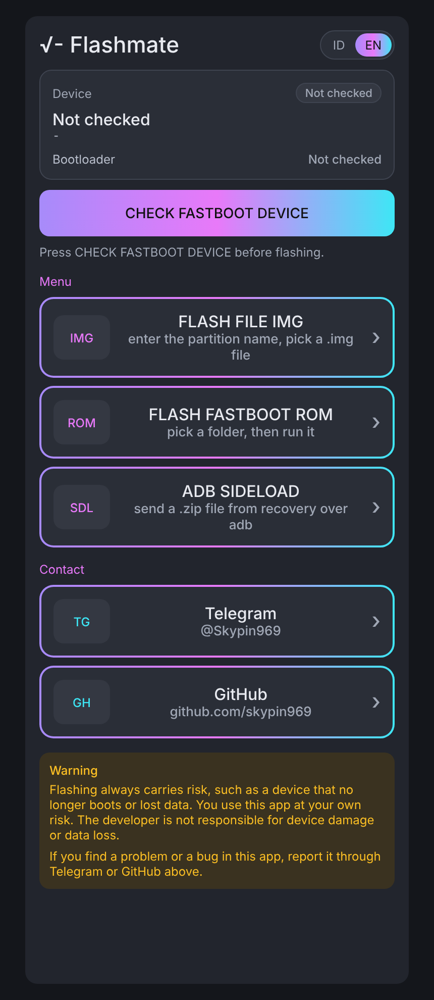
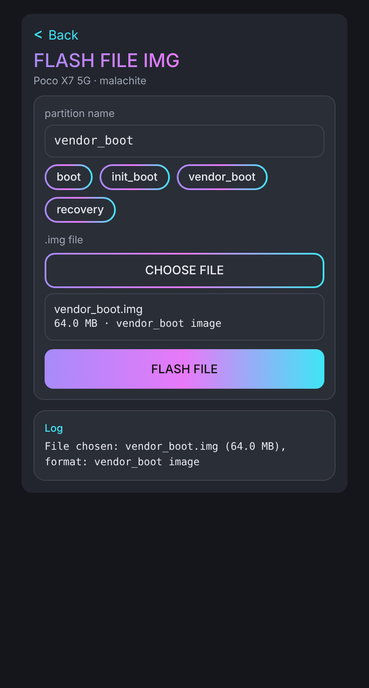
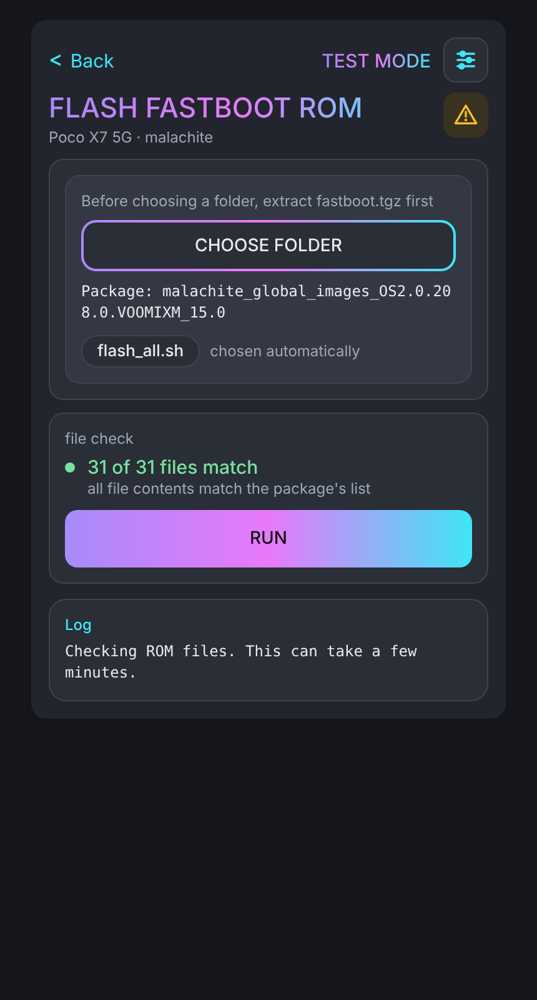
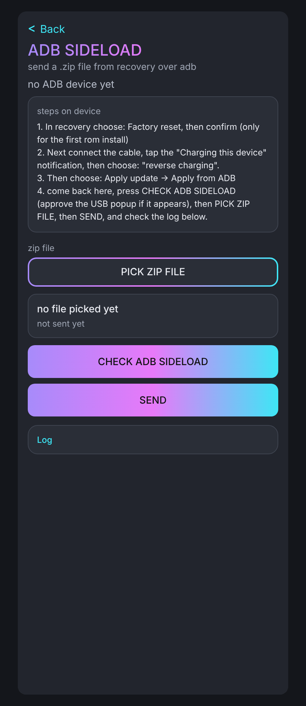

# Flashmate

Aplikasi Android untuk flash HP Xiaomi lewat kabel OTG. Satu HP dipakai sebagai pengendali yang menjalankan Flashmate, dan HP lainnya sebagai perangkat target.

## Peringatan

- Flash bisa menghapus semua data di HP target. Buat cadangan dulu.
- Untuk flash fastboot, bootloader HP target harus sudah terbuka.
- Gunakan dengan risiko sendiri. Pembuat aplikasi tidak bertanggung jawab atas kerusakan atau kehilangan data.
- Mode Uji pada FLASH FASTBOOT ROM bisa dipakai untuk mencoba alur tanpa mengirim data ke HP target.

## Kebutuhan

- Dua HP Android 7.0 ke atas.
- Kabel OTG dan kabel data.

## Menu

- **FLASH FILE IMG:** flash satu file image, misalnya boot, init_boot, vendor_boot, atau recovery, ke HP target yang berada di mode fastboot.
- **FLASH FASTBOOT ROM:** flash ROM fastboot lengkap. Ada pemeriksaan file ROM dan Mode Uji.
- **ADB SIDELOAD:** kirim file ZIP ke HP target yang berada di mode sideload.

## Tampilan

*Ilustrasi (rancangan), bukan tangkapan layar asli.*

  
  

  
  

## Perangkat yang sudah diuji

- **Redmi Note 15 4G (spinel)** sebagai target:
  - FLASH FILE IMG: boot dan vendor_boot dari file ROM 302.0. HP menyala normal.
  - FLASH FASTBOOT ROM HyperOS 3.0.302.0.WPGMIXM: Hasilnya OK, HP menyala normal.

- **Poco X7 5G (malachite)** sebagai target:
  - FLASH FILE IMG: boot, init_boot, dan vendor_boot. Hasilnya OK, HP menyala normal.
  - FLASH FASTBOOT ROM:
    - Dari ROM custom ke HyperOS 2.0.208.0.VOOMIXM. Hasil OK, HP menyala normal.
    - Dari ROM custom ke HyperOS 3.0.305.0.WOOMIXM. Hasil OK, HP menyala normal.
    - Dari HyperOS 2.0.208.0.VOOMIXM ke HyperOS 3.0.305.0.WOOMIXM. Hasil OK, HP menyala normal.
    - Dari HyperOS 3.0.305.0.WOOMIXM ke HyperOS 2.0.208.0.VOOMIXM. Hasil OK, HP menyala normal.
  - ADB SIDELOAD: LineageOS 24.0 terpasang dengan "Install completed with status 0", dan HP menyala normal (12 November 2026). MindTheGapps juga terpasang (11 November) setelah memilih Yes pada "Install anyway?".

## Batasan

- Baru diuji di dua HP. Hasilnya bisa berbeda di HP lain.
- ADB SIDELOAD untuk zip di atas 2 GB belum diuji di HP.

## Cara pasang

1. Unduh APK dari halaman Releases.
2. Pasang APK. Izinkan pemasangan dari sumber lain jika diminta.
3. Jika sudah ada versi lama yang dipasang dari build lain, uninstall dulu. Data aplikasi akan ikut terhapus.

## Lisensi

Hak cipta dipegang oleh skypin969. Kode ini boleh dilihat. Menyalin, mengubah, atau menyebarkan ulang kode ini perlu izin tertulis dari pemiliknya.

## Kontak

- Telegram: `@Skypin969`
- GitHub: github.com/skypin969

---

# Flashmate (English)

Android app for flashing Xiaomi phones over an OTG cable. One phone runs Flashmate as the controller, and the other phone is the target.

## Warnings

- Flashing can erase all data on the target phone. Make a backup first.
- For fastboot flashing, the target phone's bootloader must already be unlocked.
- Use at your own risk. The author is not responsible for damage or data loss.
- Test Mode in FLASH FASTBOOT ROM lets you try the steps without sending data to the target phone.

## Requirements

- Two Android phones running Android 7.0 or newer.
- An OTG cable and a data cable.

## Menus

- **FLASH FILE IMG:** flash one image file, such as boot, init_boot, vendor_boot, or recovery, to a target phone in fastboot mode.
- **FLASH FASTBOOT ROM:** flash a full fastboot ROM. Includes ROM file checks and Test Mode.
- **ADB SIDELOAD:** send a ZIP file to a target phone in sideload mode.

## Screens

*Illustrations (design mockups), not real screenshots.*

  
  

  
  

## Tested devices

- **Redmi Note 15 4G (spinel)** as target:
  - FLASH FILE IMG: boot and vendor_boot from the 302.0 ROM files. The phone boots normally.
  - FLASH FASTBOOT ROM HyperOS 3.0.302.0.WPGMIXM: Result OK, the phone boots normally.

- **Poco X7 5G (malachite)** as target:
  - FLASH FILE IMG: boot, init_boot, and vendor_boot. Result OK, the phone boots normally.
  - FLASH FASTBOOT ROM:
    - From a custom ROM to HyperOS 2.0.208.0.VOOMIXM. Result OK, the phone boots normally.
    - From a custom ROM to HyperOS 3.0.305.0.WOOMIXM. Result OK, the phone boots normally.
    - From HyperOS 2.0.208.0.VOOMIXM to HyperOS 3.0.305.0.WOOMIXM. Result OK, the phone boots normally.
    - From HyperOS 3.0.305.0.WOOMIXM to HyperOS 2.0.208.0.VOOMIXM. Result OK, the phone boots normally.
  - ADB SIDELOAD: LineageOS 24.0 installed with "Install completed with status 0", and the phone boots normally (12 November 2026). MindTheGapps also installed (11 November) after choosing Yes at "Install anyway?".

## Limitations

- Tested on only two phones. Results may differ on other phones.
- ADB SIDELOAD with zips larger than 2 GB has not been tested on a phone yet.

## Installation

1. Download the APK from the Releases page.
2. Install the APK. Allow installs from other sources if asked.
3. If an older version built from a different source is installed, uninstall it first. App data will be erased.

## License

Copyright is held by skypin969. You may view this code. Copying, modifying, or redistributing it requires written permission from the owner.

## Contact

- Telegram: `@Skypin969`
- GitHub: github.com/skypin969
